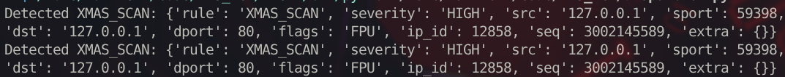

# IDS TCP Flags (Scapy)

**Proof-of-understanding project.** An educational, signature-based Intrusion Detection System that works at the network layer (OSI L3/L4). It captures packets with Scapy, inspects TCP flag combinations, and detects port-scanning techniques that a legitimate TCP stack would never generate.

> **Note:** This is not a replacement for Snort or Suricata. The goal is to demonstrate hands-on understanding of TCP internals, packet capture mechanics, and the false-positive trade-offs of signature-based detection.

## 🚀 Features

- Detects anomalous TCP flag combinations used in port scanning:
  - **NULL scan** — no flags set
  - **XMAS scan** — FIN + PSH + URG
  - **FULL-XMAS scan** — all flags set
  - **SYN+FIN**, **SYN+FIN+PSH**, **SYN+FIN+RST**, **SYN+RST**
- Single dispatcher: one `sniff()` call routes every packet through all rules.
- Rules return structured events (`dict`), decoupling detection from output — the same rules can later feed a console logger, a file, a Telegram bot, or a GUI without modification.

## 🛠️ Requirements

- Python 3.9+
- **root privileges** or the `CAP_NET_RAW` capability — required for raw socket access on Linux
- `scapy` (installed via `requirements.txt`)

## 📦 Installation & Usage

```bash
# 1. Clone the repository
git clone https://github.com/your-username/IDS_TCP.git
cd IDS_TCP

# 2. (Recommended) Create a virtual environment
python3 -m venv .venv
source .venv/bin/activate

# 3. Install dependencies
pip install -r requirements.txt

# 4. Run (root required for packet capture)
sudo python dispatcher.py
```
## 🧪 Example output
<figure>
  
  <figcaption>Detecting an XMAS scan with nmap -sX localhost</figcaption>
</figure>

After sending an XMAS packet to `127.0.0.1:80`:
{'rule': 'XMAS_SCAN', 'severity': 'HIGH', 'src': '127.0.0.1', 'sport': 20, 'dst': '127.0.0.1', 'dport': 80, 'flags': 'FPU', 'extra': {}}


## ⚠️ Known limitations

This section documents what the detector **does not** do, what it **deliberately omits**, and where **false positives or noise** are expected. Everything listed here is a conscious trade-off, not an oversight.

### Detection scope

- **Signature-based only.** Detects known anomalous TCP flag combinations (NULL, XMAS, SYN+FIN, etc.). Novel or evasive techniques — flag permutations outside the rule set, timing-based scans, packet fragmentation — will not be detected. This is inherent to the signature approach; it is not a bug.
- **No flow-state correlation.** Each packet is analyzed in isolation. Multi-packet techniques (slow scans, session hijacking) are out of scope without TCP stream reassembly.
- **IPv4 only.** The BPF filter (`tcp and ip`) intentionally restricts to IPv4. IPv6 packets use the `IPv6` layer and are not analyzed. Adding IPv6 requires a separate handler path.
- **No payload inspection.** Only L3/L4 headers are examined. Application-layer attacks (e.g., malicious HTTP payloads) are invisible to this tool — by design, to avoid handling sensitive data.

### Deliberate omissions

- **Maimon scan (FIN+ACK) is disabled.** FIN+ACK is the standard TCP connection-close sequence. Without flow-state context the rule fires on every normal teardown — a ~100% false-positive rate. The rule is kept in the source (commented) for reference.
- **Single-flag heuristics (SYN/ACK/FIN floods) are not implemented.** A single SYN is a normal connection attempt; it only becomes suspicious in aggregate (e.g., 1000 SYNs to distinct ports from one source within seconds). Detecting this requires sliding-window counters — planned as a separate feature, not a packet-level signature.

### Known behavior to be aware of

- **Loopback duplicates events.** On `lo`, Linux delivers every packet to `AF_PACKET` sockets twice (TX and RX). Verified with `ip_id` and `seq` — identical across both events, confirming kernel-level duplication. `tcpdump` deduplicates at display time; Scapy does not. On real interfaces (`eth0`, `wlan0`) no duplication occurs. Fix: deduplication by `(src, sport, dst, dport, seq)` before adding any output channel.
- **RST+ACK noise in the log.** When scanning a closed port, the kernel responds with RST+ACK, which appears in the log as an unrelated `RA` packet. This is expected kernel behavior, not a false positive — but it adds visual noise and will need filtering before an output layer.

### Technical debt (roadmap)

- **Deduplication** by 5-tuple + sequence number — required before adding any rate-limited output (Telegram, etc.).
- **CLI arguments** (`--iface`, `--filter`, `--severity-threshold`) — currently the interface is hardcoded to `lo` for reproducible local testing.
- **Unit tests** for each rule using synthetic packets (`IP()/TCP(flags=...)`) — no network needed.
- **Graceful shutdown** (SIGTERM handler) to flush pending state.
- **Structured logging** to a file, with rotation.
- **Output abstraction** — the rules already return structured `dict`; the current `print` is a placeholder for file/Telegram/GUI emitters.
